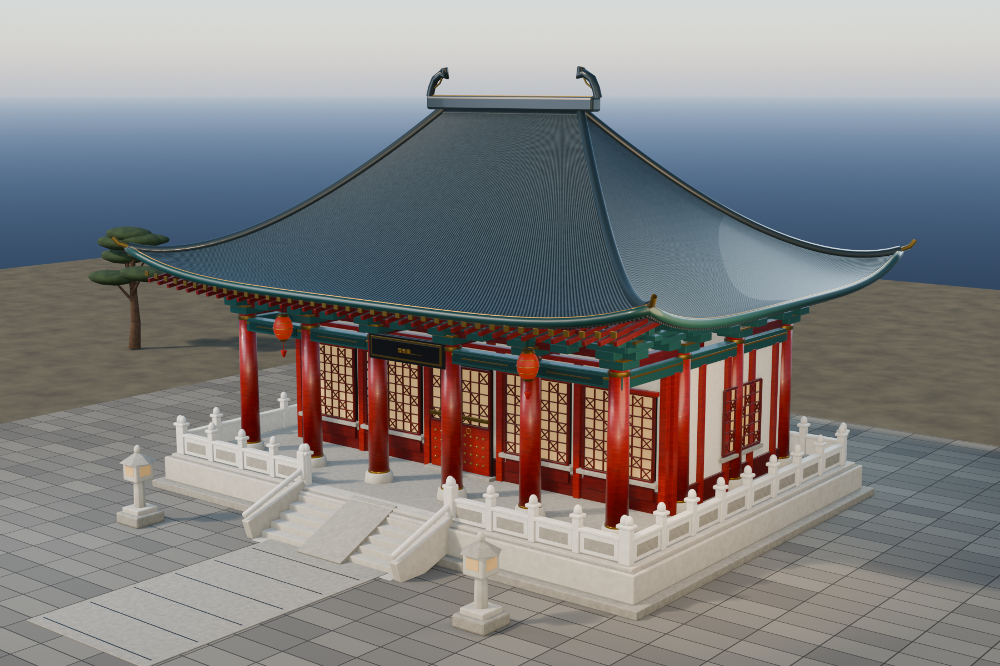
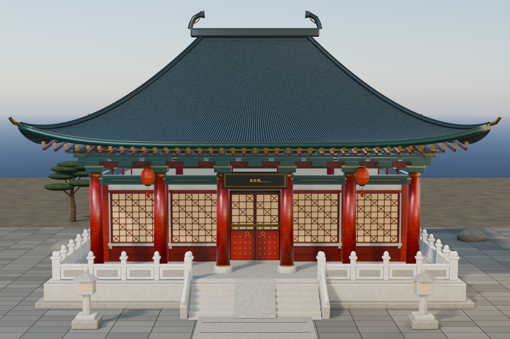
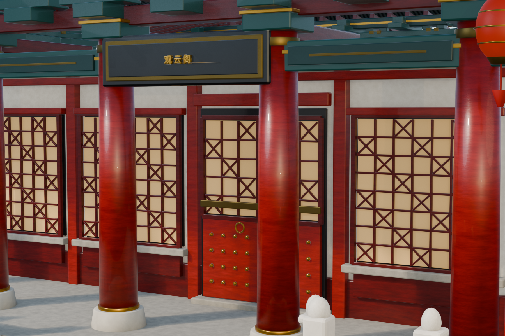

# 观云阁 · 中国古典建筑

一套用 Blender 5.2 脚本生成的中国古典木构厅堂资产。模型按五开间厅堂组织，包含完整的台基、柱网、墙体、门窗、斗拱、屋面与庭院场景。

## 文件

- `chinese_hall.blend`：完整场景，含建筑、庭院、灯光和三个机位。
- `build_chinese_hall.py`：可重复生成模型与渲染的 Blender Python 脚本。
- `renders/hero.png`：三分之四透视主展示图。
- `renders/elevation.png`：正立面图。
- `renders/detail.png`：门廊与匾额细节图。

## 建筑内容

- 五开间单檐庑殿顶，面阔约 19.5 m，屋脊高约 12.6 m。
- 石砌台基、须弥座层次、白石栏杆、御路踏跺。
- 朱红木柱、柱础、额枋、彩画横枋和 30 余组层叠斗拱。
- 方格棂花门窗、中央板门、铜门钉、铺首门环。
- 曲面举折屋面、起翘檐角、筒瓦纹理、正脊、垂脊与鸱吻。
- 黑底金字“观云阁”匾额、悬挂宫灯、石灯笼、松树与庭院铺装。

场景按 `01_Stonework`、`02_Timber_Frame`、`03_Facade_and_Lattice`、`04_Curved_Roof`、`05_Ornaments_and_Lanterns` 分集合组织，建筑整体挂在 `Chinese_Classical_Hall` 根空物体下，便于整体移动和缩放。庭院、灯光和相机位于独立的 `06_Presentation` 集合。

材质全部为程序化材质，不依赖外部贴图；匾额字体使用项目内的 `assets/fonts/NotoSansCJKsc-Regular.otf`。

## 重新生成

```bash
# 完整分辨率，主图
blender -b --python assets/models/chinese_hall/build_chinese_hall.py

# 低分辨率预览，并一次输出三个机位
HALL_PREVIEW=1 HALL_RENDER_ALL=1 \
  blender -b --python assets/models/chinese_hall/build_chinese_hall.py
```

场景使用 Blender EEVEE、AgX 色彩管理和 Nishita/多重散射天空。打开 `.blend` 后可直接切换 `Camera_Hero`、`Camera_Elevation`、`Camera_Entrance_Detail` 查看。

## 预览






