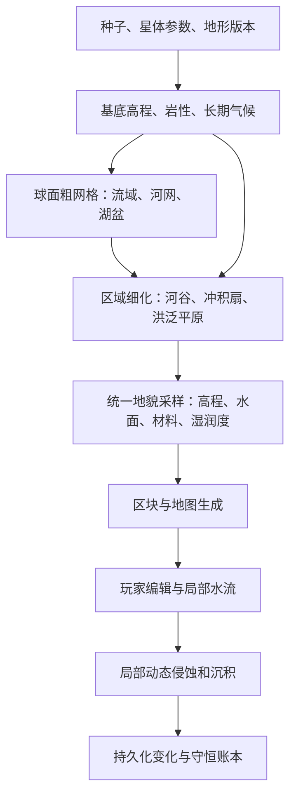

# 地理现象与地貌真实性方案

状态：实施中。M0 已接入版本保留；M1–M3 已有排水图谱、母星河谷/湖盆、冲积扇和洪泛沉积实现及回放。M4 首批加入河流阶地，具体边界和验证见文末；其他扩展地貌仍待实施。
冲积扇是其中一种有条件出现的地貌；首版不要求在游玩时间内模拟其长期形成过程。

## 1. 当前基础与缺口

- `terrain.c` 已有球面噪声地形、山脊、海岸和海底地形；Homeworld 高程目前主要由
  大陆度、山脊、峰值及细节噪声组合，尚无统一的流域/河网约束。
- `surface_topology` 已有六面球面地址、跨面偏移与经线/极点别名处理，可用于稳定空间身份。
- `terrain_home_materials.c` 和 `terrain_geology.c` 已有砾石、砂、粉土、泥、冲积土、
  岩性等材料；目前冲积土主要是环境条件下的噪声分布，不能代表完整冲积扇。
- `hydrology_model` 已有侵蚀、搬运、沉积和守恒基础；运行时仅覆盖一个 128×128
  区域的 32×32 粗网格，用于局部水文及气候反馈，尚不生成全球河网或写入河谷体素。
- `fluid.c` 管理玩家附近的体素水。火山灰雨蚀目前计入出口账本，未接入泥沙搬运。
- 旧地形生成版本为 6，新世界版本为 7。存档已经记录版本，但读入不同版本主要处理安全落点，
  尚没有完整的“按存档版本选择历史地形生成器”机制，必须先补齐。

## 2. 地貌范围与顺序

| 阶段 | 交付内容 | 形成约束 |
| --- | --- | --- |
| A | 流域、分水岭、干支流、保留洼地与湖盆 | 由基底高程、汇水面积和长期气候确定排水关系 |
| B | 河谷、峡谷、急流/瀑布、湖泊与湿地 | 河网约束河床，坡降和岩性影响谷宽、下切及落差 |
| C | 冲积扇、洪泛平原、沉积带 | 沟谷出口、坡度减小、泥沙供应和可用空间共同决定 |
| D | 曲流、旧河道、牛轭湖、河流阶地 | 在适宜的平原河段生成，表达河道迁移与下切历史 |
| E | 河口、三角洲、海滩、沙洲、潟湖及海蚀崖 | 来沙、海岸坡度及波浪/潮汐暴露的简化分类共同决定 |
| F | 坡脚碎石、滑坡遗迹、沙丘、冰川及喀斯特地貌 | 分别受坡度/岩性、风与沙源、冰候或可溶岩约束 |
| G | 玩家附近的泥沙输运、沉积与局部地貌变化 | 接入有限水量、真实地形修改和物质守恒 |

首个可玩版本交付 A–C：一条连贯的“山地—沟谷—山前—平原—湖泊或海洋”路径。
D–F 分别扩展，不能把每一种现象固定塞进每个流域。G 在静态地貌及水体边界稳定后实施。

## 3. 数据流和状态归属

建议新增纯计算的 `world/landform_model`、按星体管理的 `world/landform_runtime`，
以及把采样结果接入现有地形的 `world/terrain_landforms`。名称可在实施时调整，
依赖方向必须保持：模型不查询当前游戏状态，不依赖渲染或背包。

粗网格保存：基底高程、汇水面积、下游地址、流域/河段 ID、长期径流指标、湖盆及出口。
区域记录保存稳定的中心线、河床纵剖面、宽度、沉积区边界和材料比例。
对外采样建议返回：

- 最终地表/河床高程与是否存在水面；
- 河段/流域身份、河道距离、坡降和沉积厚度；
- 砾石、砂、粉土/泥的材料比例与排水/湿润条件；
- 地貌类别和诊断原因，供 DSL 与地图覆盖层检查。

初始长期气候只能读取星体基线和基底高程，不能读取包含水文反馈的当前天气，
否则会形成“地形查询→气候→水文→地形查询”的递归，也会让生成结果随时间改变。
当前天气只影响后续运行时水量和湿润状态。

## 4. 流域与河网算法

1. 在统一球面粗网格上采样基底高程和长期气候。建议先评估每面 128×128 单元，
   共 98,304 个单元；这是待基准测试的起点，不作为固定精度承诺。
2. 跨面邻接使用球面地址和稳定单元 ID；距离和汇水面积按球面几何计算，
   不直接把经纬图格子视为等面积。测试跨面相邻关系的互反性和极区面积。
3. 用确定性的洼地/溢出口分析建立排水图。Priority-Flood 可辅助确定溢出口和
   平坦区排序，但不能把所有洼地都填平：保留选定湖盆，内流盆地有明确终点。
4. 用下游拓扑累计汇水面积，再结合长期有效降水估算径流指标。相同高程时按
   固定排序处理，确保没有路由环和线程/遍历顺序差异。
5. 达到条件的汇流路径生成河段；干旱区域可保留季节性干沟，不强制全年有水。
6. 区域细化依附粗网格河段，固定共同边界的入口、出口、河床高程和水面条件。
   局部横向摆动必须位于所属谷地，不能穿越分水岭或与邻区各自造出不相连的河。
7. 先确定河床与湖泊水面，再加细节噪声；细节不得重新堵住主河道或制造逆坡。

主排水图采用稳定下游关系；冲积扇/三角洲上的分流作为显式派生支路，
分配流量后必须满足总量约束，不把每条支路都赋予整条主河的流量。

## 5. 地形、水体和材料必须同时落地

### 河谷与湖盆

河宽/谷宽由汇水规模、坡度和岩性共同决定。山区允许狭谷和陡降段，平原河谷逐渐变宽。
首版不追求水力学精解，但必须有连续河床和自洽水位：普通河段向下游降低，
湖泊与回水段允许近似水平，瀑布只出现在明确落差处。

有出口湖以溢出口限制水位；无出口湖依据气候水量条件确定稳定/季节性湖面。
湿地优先出现在浅水、排水受限或地下水浅的地方；盐滩还要满足封闭排水、蒸发及盐源条件。

现有程序化海洋的补满语义不能直接复制到所有河流单元。首版需明确：
初始地形水体按统一水面生成；局部运行时只在显式入流/出流边界交换水，
交换量记入账本。玩家开渠或堵河后，已持久化水量不因区块重载重新灌满。
若需要稳定上游供水，应使用有流量上限的河段入口，不能让每个河道体素无限补水。

### 冲积扇与洪泛平原

冲积扇候选点必须同时具备：受约束沟谷的出口、明显的坡度/束缚下降、足够来沙，
以及山前可展开的空间。扇面方向服从出口流向和周围地形，遇山脊或邻近扇体时截断/融合。
尺度取决于流域和泥沙供应；保留主沟或分流通路，不能生成堵死自身入口的扇体。

材料分选采用概率和带宽过渡：近端粗砾比例高，远端砂和粉土比例提高，
不画严格同心色环。泥石流主导的扇体可混杂、分选差，留作后续类型扩展。

洪泛平原沿低坡河段展开，可包含天然堤和较低的背水洼地。先生成平原及细沉积带，
再在 D 阶段加入曲流、废弃河道和历史阶地；初始就保留相应身份与空间约束。

### 方块和植被

首版复用现有砾石、砂、粉土、泥、冲积土和岩石，不先扩充方块表。
材料分布读取同一地貌采样结果，植被再使用排水和湿润条件，避免河床长旱地树、
湿地铺干砂、扇面只换贴图却没有高程变化。既有玩家编辑始终覆盖生成基底。

## 6. 确定性、缓存和存档

- 为世界保存并实际启用地形生成版本。当前版本 6 的世界继续使用旧算法，
  新世界才默认使用新地貌；保存旧世界不得把它悄悄改写成最新生成版本。
- 缓存身份包含星体 ID、种子、生成版本及影响生成的星体参数指纹。
  Homeworld 与具备地表液态水条件的行星分别接入；干燥/冰冻星体不直接套用湿润河网。
- 每个星体的粗网格在区块生成前构建为不可变结果，工作线程只读。切换世界/星体时，
  带旧代次的构建结果丢弃，不能发布到当前世界。
- 按需缓存区域细化结果，邻区重叠边界必须从同一粗网格约束生成。无缓存查询和
  有缓存查询应给出一致结果，不允许“先到的区块决定河道”。
- 建议先限制两份星体粗网格常驻；约 98k 单元、每单元 32–64 字节时，单份主体
  数据约 3–6 MiB，构建临时数组、区域记录和索引另计。实际结构和耗时以基准测试确定。
- 生成数据可由版本化种子重建；玩家编辑、动态沉积、水量及入口/出口累计量必须保存。
  旧存档迁移、坏档事务回滚、再次保存以及地形版本的跨星体传播均需测试。

## 7. 动态泥沙阶段的衔接

G 阶段先做封闭水池、短沟渠和一个明确出口，避免同时扩大地貌和物理模型范围。
先引入粗砾、砂、细泥/灰三个行为类别；方块表现与输运质量分开定义，
火山灰的 1/1024 方块单位必须显式转换到体积/质量，不能与水文 kg/m² 直接相加。

灰蚀可在有承接水体时转为悬浮泥沙；没有承接路径的量保留为可审计出口。
体素水与粗网格水文之间选定唯一物质所有者及交换接口，不能各自计算同一份泥沙。
输运依据实际已提交水通量，沉积依据携沙能力/沉降参数，挖掘沉积物进入现有定量采集事务。
干涸、汽化、卸载、容量耗尽和出界都需要规定沉积或停放/出口行为，不得静默删除泥沙。

初始生成地貌表达地质历史，不声称满足一次有限时长的侵蚀计算；
运行时开始后，新增侵蚀、搬运、沉积、采集及出口必须遵守同一物质账本。

## 8. 实施里程碑与验收

| 里程碑 | 具体交付 | 通过条件 |
| --- | --- | --- |
| M0：版本及基线 | 历史生成器选择、不可变基底采样、地貌结果/缓存契约 | 旧世界采样不变；保存重载仍选择原版本；无地形/气候递归 |
| M1：球面排水骨架 | 粗网格、流域/河段 ID、汇水与湖盆分析 | 无路由环；流向正确；跨面/经线/极点连续；缓存和构建顺序不改结果 |
| M2：可见河谷 | 河床、谷地、水面与受控水边界，接入区块和地图 | 河道不断裂、不爬坡；湖泊不漏底；编辑/堵河不被重载覆盖 |
| M3：山前与平原沉积 | 条件化冲积扇、洪泛平原、沉积材料和湿润度 | 扇体接沟口、沿坡展开、不穿山；材料渐变；没有条件时不生成 |
| M4：扩展地貌 | 按 D–F 逐类增加，并给出独立基准种子 | 出现率受条件控制，各类地貌具有可解释的空间关系 |
| M5：局部动态沉积 | 灰→水中泥沙→沉积→采集，接入存档和账本 | 水/泥沙闭域守恒；出口计量；分帧/读档/卸载复现 |

M0–M3 为本次建议的首轮实施范围，每个完成阶段单独 commit。
首轮先在 Homeworld 非平坦地形验证，再接适宜行星；平坦调试世界维持原语义。

DSL：`landform inspect` 和 `landform find` 已实现（详见 debug-dsl.md）；覆盖层仍为提案：

- `landform inspect`：显示地貌、流域/河段 ID、汇水面积、坡降、水面、材料比例和版本；
- `landform find TYPE RADIUS`：有界查找可复现地点；查询只读，不改变模拟或消耗随机数；
- `landform debug drainage|basins|sediment|off`：叠加流向、流域边界或沉積分选信息。

图形验收固定湿润山地、半干旱山前、平原及闭流盆地种子，从上游到下游飞行截图，
检查整体连贯性和近处方块表现。另设跨区块、跨球面面界、极区、缓存淘汰、切换星体、
挖渠堵水和保存重载路线。使用项目 DSL / `--debug-*`，不依赖外部窗口控制。

性能验收记录粗网格构建耗时、峰值内存、区域缓存命中率、区块生成与地图采样耗时
的中位数及高分位值。构建不得进入每帧/每体素热路径；预算回退采用预先固定的精度配置，
不能按机器瞬时负载改变同一种子的地貌。具体预算在 M0 基线测量后固定。

实施说明：v6 世界保留 v6 生成路径；v2–v5 沿用项目既有的 v6 兼容处理，未恢复历史生成器。地形版本在读档扩展状态前安装，坏档通过已有完整检查点事务恢复。

## M4 第一批：河流阶地（2026-10-06）

新世界使用地形版本 8，版本 7 保留原采样；两者分别缓存，版本切换期间不暴露旧版本图谱。
阶地仅在常年径流、坡降 0.001–0.025、非湖盆、同流域且水面高于海平面至少 6 格的河段出现。
在河轴两侧 3–7 倍河宽范围，把已有谷肩切削到河面以上 4 格的历史台面，边缘平滑过渡。
原地形必须高于台面且不超过台面 6 格；不抬高低洼地、不切穿高山，也不修改现代河床。
复用砾石/砂/粉土，比例 0.45/0.35/0.20，沉积厚度最多 2 格，低湿润度且不生成水。
这是受地形约束的静态历史近似，不模拟历史流量、动态下切或阶地年代；曲流、牛轭湖、海岸和其他 D–F 地貌尚未交付。

基准种子 `1448040515`：母星 `(555, 510)` 为阶地，地表高程约 `111.421`，河段 `6450`。
`tests/scenes/landform_terrace.dsl` 在独立存档目录查找、检查干燥沉积、保存重载并截图。
模型测试覆盖出现条件、山脊/低地排除、干旱/陡坡排除、河床保留和 v7 一致性；
地形集成测试覆盖自然基准点、实际方块、经线别名和 v7/v8 缓存切换。

验证记录：模型、DSL 解析、地形集成和版本边界测试通过；模型 ASan/UBSan（含泄漏检查）通过；
架构检查通过。Hyprland 下 `landform_terrace` 与原 `landform_replay` 两条图形路线通过，
共输出五张截图；已人工查看阶地俯视截图。该次模型基准约 0.033 秒/图谱、5.63 MiB，
这是本机测试样本，不是完整渲染性能承诺。
