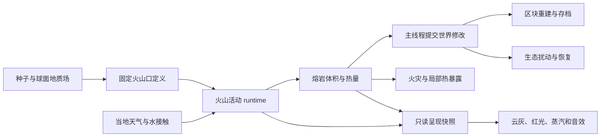

# 火山与地质活动设计草案

状态：G1 的固定喷口、活动预览、存档和 DSL，以及 G2 的有限熔岩、热量、
局部流动和冷却成岩已实现；G3–G4 仍为设计提案。以下全系统设计基于
`a2ad465` 的原有能力；当前实现边界见 [实现记录](architecture/18-volcano-preview.md)。

## 1. 目标与第一版范围

让一个固定火山口能经历预兆、喷发、熔岩流动和冷却，留下可探索、
可开采、逐渐恢复的地貌。玩家能够提前察觉危险、判断流向、绕行或筑堤，
回来后仍能看到同一次喷发的结果。

第一版选择小规模玄武质溢流喷发：温度和黏度控制缓慢熔岩流，
少量喷溅和灰羽提供远处可见的信号。第一版不承诺真实板块运动、
大型爆炸性喷发、火山碎屑流、泥石流或动态山体崩塌。

已有基础：

- 行星表面场已有 `volcanicActivity`、火山锥、破火山口、熔岩通道形态。
  它们由种子与位置生成，目前没有可保存的独立火山口或喷发事件。
- 已有岩浆方块、玄武岩、火山灰、浮石、黑曜石等材料；材料存在不等于
  熔岩流动、冷却反应已经实现。
- `fluid` 的可流动体积和传输逻辑针对水，不能直接将岩浆接入现有水量数组。
- 已有固定模拟时钟、天气位置采样、火灾、生态、环境方块修改和原子存档。

成功标准：一条确定性 DSL 路线能从休眠走到冷却；体积账本闭合；
给定相同地形、水量和天气边界输入，改变帧率、图形质量或中途存读档
不会改变同一活动区的地质物理结果；
玩家离开再返回不重复喷发、不补放积压伤害、不重复生成岩石。

## 2. 玩家经历与活动状态

| 阶段 | 玩家能看到或听到 | 世界变化 |
| --- | --- | --- |
| 休眠 Dormant | 固定火山地貌，偶发弱气柱 | 补给恢复，等待下次活动条件 |
| 不安 Unrest | 气柱增强、低频隆隆声、局部轻震 | 压力升高，给出逃离和观察时间 |
| 喷发 Erupting | 喷口变亮、喷溅、沿坡流动的熔岩 | 有限岩浆库存持续释放；热量可引燃可燃物 |
| 衰退 Waning | 喷溅变少，流动逐渐停止 | 补给下降，已流出的岩浆仍继续流动和冷却 |
| 冷却 Cooling | 暗壳、局部红缝、接水蒸汽 | 熔岩固化，局部热危害下降 |
| 恢复 Recovery | 灰地、裸岩，随后出现先锋植被 | 地表扰动衰减，火山口可进入下一轮休眠 |

这些是可读标签，不是按计时器无条件播放的动画：压力与库存允许才释放岩浆，
通道堵住时不能穿墙生成；没有活动熔岩才能完成冷却阶段。
压力不等于真实地壳应力，第一版采用可调的现象模型。

初始调参范围建议：预兆 30–90 模拟秒、喷发 60–180 模拟秒，
冷却随体积、温度和水接触决定；恢复使用模拟日。它们是待试玩的参数，
不是科学尺度或已测得结果。正常 1× 时钟下模拟秒与现实秒一致。
雨水能增加冷却，不应几秒钟扑灭一个持续供给的喷口。

热伤害以接触岩浆和近距离辐射为主；弱灰羽先影响可见度和空气表现。
低质量画面仍要有可见红光和预警声，不能因关闭粒子而隐藏危险。

## 3. 核心对象与状态归属

| 对象 | 归属 | 关键内容 |
| --- | --- | --- |
| 火山口定义 VentDefinition | 确定性地质生成 | 稳定 ID、所在天体、球面地址、喷口位置、潜力、物质类型 |
| 火山口状态 VentState | 地质 runtime | 阶段、活动时间、压力、岩浆库存、补给、喷发序号 |
| 熔岩单元 LavaCell | 熔岩 runtime | 坐标、体积、热量、液相比例、上一 tick 的流向 |
| 地质扰动 GeologicalScar | 地质 runtime | 固化体积、灰沉积、热暴露、恢复进度；不重复保存火灾燃料 |
| 世界修改 TerrainMutation | 世界存储 | 实际方块变化、来源、修订号与持久化编辑 |
| 呈现快照 VolcanoVisualSnapshot | 表现层持有副本 | 喷口、灰羽、热辉光、流面、声音强度，全部从物理状态派生 |

地质 runtime 由游戏组合层创建和释放，主线程唯一拥有可变状态。
渲染器拥有 GPU 缓冲和粒子资源；世界卸载或程序退出时分别释放。
后台线程如果参与，只接收不可变地形/气候快照并返回候选结果，
不持有 Chunk 指针、不直接写方块。



图中箭头表示数据传递。推进顺序和存读档由 `app` 层控制；
表现层不反向修改物理。生态系统通过中立的扰动数据接口读取地质结果，
世界模块不导入生态实现。

## 4. 火山口在哪里

以现有行星火山潜力场为依据，在固定球面候选网格上选局部峰值，
结合坡形、海拔、海洋覆盖和最小间距确定喷口。候选点用稳定哈希排序，
邻区比较包含边界光环，避免经线接缝或两区同时生成同一个喷口。

稳定身份建议使用 `bodyId + SurfaceAddress + generatorVersion`，
不使用浮动局部原点，也不根据摄像机位置或发现顺序分配 ID。
地形采样可以发现候选定义；`inspect`、地图和渲染查询不能创建活动记录。
是否接纳活动记录由模拟调度器决定，检查已有保存状态后再初始化。

第一版自然火山优先用于已有火山地形的行星；本星球通过 DSL 验证。
本星球的自然火山分布作为后续地形版本单独评估，避免悄悄改变旧世界。
旧存档中的新喷口不能覆盖玩家编辑；喷口上已有建筑或未知区块时暂缓激活。

第一版对候选峰值建立最小可见喷口需要环境修改，但不重生成整座山。
喷口位置、形态和地形生成版本一经保存就固定，升级不能把活动火山搬家。

## 5. 熔岩、冷却和水的交互

独立实现 `lava_model` 与 `lava_runtime`，沿用水流模块的固定步、体积计量和
区块接口经验，先不把水求解器重写成通用多流体系统。

模型至少保存体积与显热/潜热账本。混合时合并体积和热量后求温度，
不能直接平均温度；冷却先降低热量，再改变液相比例与黏度。
优先向下流，再根据液面高差向侧面传输。冷岩浆黏度大、流速慢，
不具备无限复制的“源方块”。喷口是唯一新增物质量的显式来源。

每个 tick 使用前一状态计算通量，再一次性提交，避免数组遍历顺序改变流向。
边界未加载就按不透流处理，保留上游体积；不能把未知区块当空气。
静态生成的岩浆海不自动升级成无限供给源，第一版只管理喷发拥有的岩浆。

物质守恒必须满足：

`初始岩浆库存 + 累计地下补给 = 喷口剩余库存 + 活动熔岩 + 已固化岩石 + 明确记录的移出量`

第一版不允许跨未知边界泄流，该项移出量应为零；玩家开采、收集或
明确销毁物质要记入移出量。停止供给和限流都必须保留库存。
灰与喷出固体若有实际沉积，使用单独的物质账本，并从喷发物源扣除，
不能根据视觉粒子数量生成可开采物。此账本按固定密度的等效体积计量，
第一版不模拟冷却收缩和成分分离。
冷却为岩石需要保存固相体积：不能把任意少量岩浆变成一个完整岩石方块。
不足一方块时先保留部分固化单元和相应表面/碰撞高度，足量后才转为普通岩石。
这部分网格和碰撞支持属于熔岩阶段的必要工作。完全冷却的部分固体转入
持久化沉积记录，不继续占用热熔岩活动预算；再次被熔岩覆盖时重新接纳。

慢冷以玄武岩为主；快速水冷可产生黑曜石，使用简化材料规则并在文档注明。
接水时由游戏层按固定顺序同时提交取水、失热、固化和蒸汽通量，
任一条件失效就整个反应重新计算，避免水和熔岩都自称消耗了同一份水。
蒸汽先做视觉和排出通量，不增加气体流体求解器。爆炸和蒸汽压力不在第一版。

## 6. 接入现有系统

| 系统 | 接入方式 | 明确边界 |
| --- | --- | --- |
| 天气 | 按火山口、熔岩位置采样温度、降水、风 | 风吹灰羽，不决定地下岩浆补给 |
| 火灾 | 热暴露达到阈值后通过统一点火入口提交来源与强度 | 火山不另建一套燃烧状态；需要拆开现有天气伤害开关与点火来源策略 |
| 水流 | 接触反应通过应用层协调双方体积提交 | 不在水求解器里隐式生成、删除岩浆 |
| 世界 | 环境来源的方块修改、区段脏标记合并 | 提交时核验修订号，避免旧结果覆盖玩家刚放置的方块 |
| 动物与玩家 | 中立的温度/热暴露/危险区域采样 | 伤害与逃离由各自玩法系统决定 |
| 生态 | 灰厚、温度、裸岩比例、扰动年龄输入区域环境 | 少量冷灰可能改善矿物供应；厚灰覆盖和热熔岩先抑制生长 |
| 光照与音效 | 红光、喷溅、灰羽、隆隆声由快照派生 | 剔除或丢弃视觉粒子不能影响体积、伤害和随机序列 |

第一版只做局部灰羽遮光和落灰；不接入全球辐射柱，也不产生全球降温。
灰沉积对营养状态的作用应经过现有营养输入账本，不能无上限增加肥力。

增加独立的“火山活动影响”开关：关闭时暂停该子系统的物理推进和伤害，
保留已保存状态、既有地貌和可见熔岩；重新开启从该状态继续，不补算关闭期间。
此前已经点燃的普通火灾由火灾系统继续管理，关闭火山不能回滚它们。
默认值在实施阶段统一纳入设置迁移测试。DSL 预览在隔离测试世界运行，
停止效果不能冒充回滚已经产生的永久地形修改。

## 7. 时间、加载范围与预算

火山生命周期拟采用 2 Hz，熔岩传输拟采用 10 Hz，均由现有 60 Hz
固定模拟步触发；渲染按快照插值。具体频率要经过流速与稳定性测试。

初始活动预算建议：同时 2 个详细喷发，活动熔岩总量最多 2,048 单元，
灰沉积每地质 tick 最多 32 个候选列。均为待测起点，不是性能承诺。
已接纳的全部熔岩必须每个物理 tick 推进；不能通过轮询漏算时间来省成本。
容量不足时限制喷口释放和向新单元扩张，保留物质和显式受限状态。
可合并一个 tick 的区块重建请求，不按每滴岩浆重建网格。

第一版加载语义明确采用局部模拟：

1. 火山进入详细模拟范围后，固定步推进；在范围内转头或改变画质不影响结果。
2. 离开范围或切换天体时，在完整物理步边界将事件与流场停放并保存。
3. 停放期间不持续喷发、不积累待释放岩浆，也不远程破坏方块。
4. 返回后恢复同一事件及同一活动时间，不将墙钟经过时间转换成补喷发。
   边界尚未加载的单元仍保持不透流。
5. 接纳使用距离滞回和稳定 ID 排序，防止边缘来回切换；活动容量满则候选等待，
   不挤掉正在喷发的已接纳事件。直接跨世界传送允许停放。

这不模拟玩家离开期间的地质演化。未来若做离屏宏观演化，需要另加守恒的
粗网格和事件日志，不能仅推进阶段时间再事后补写地形。
大幅快进同样遵守这一边界，先停放详细地质域，不能跳过中间物理步骤。

地质记录的持久化存储与活动预算分开：休眠/停放不等于可以丢弃。
达到存储限制时停止接纳新事件并提供计数，不淘汰尚有熔岩或玩家可见结果的记录。

## 8. 持久化和正确性

增加独立、带版本的地质 payload，由现有原子世界存档写入；提升世界格式版本，
旧档缺少 payload 时初始化空 runtime。定义明确字节编码，避免直接写 C 结构体布局。
载入先完整校验临时状态，再提交，不让损坏 payload 留下半恢复的活动。

保存内容包括稳定火山口身份、生成版本、事件序号、阶段、活动时间、
压力/库存、活动和停放域、熔岩体积/热量/固相、沉积与恢复状态、
采样游标及随机计数器。存档在完整 tick 提交后截取，保存分频余量或规范化检查点。
瞬时粒子、GPU 资源和待显示音效不保存。

必须维持的约束：

- 一个球面火山口只有一份状态，经线/极点别名不能复制火山。
- 读查询无副作用；看地图、截图和暂停不会触发新喷发。
- 物理随机数按火山口和事件分流，不能与粒子随机数共用。
- 点火、沉积、固化有事件/步骤身份，恢复不能重复执行副作用。
- 两条熔岩流汇合后由空间单元唯一拥有体积；单元不随某个喷口退出而被删除。
- 世界编辑完成后，再发布物理结果与渲染快照；异步结果按世界代次和修订号校验。
- 冷却岩石和灰层是永久环境修改，不套用天气雪冰的自动还原逻辑。

## 9. 最容易出问题的情形

| 情形 | 处理与验证 |
| --- | --- |
| 玩家在熔岩前沿放墙 | 重读方块，重新计算可容纳体积；不能穿墙或丢失岩浆 |
| 喷口被封住 | 不凭空排出物质；压力饱和时停补给并记录受阻，第一版不隐式炸开建筑 |
| 玩家传送导致区块卸载 | tick 边界停放；未知边界不透流；返回不一次性补做伤害 |
| 满载、多流汇合 | 限制接纳和新增体积单元；保留库存，所有已接纳单元持续按时推进 |
| 高温冷却恰好遇到保存 | checkpoint 前完成反应和方块提交，恢复后既不双重取水也不多生成岩石 |
| 后台地形结果在切换行星后返回 | 世界代次不符就丢弃候选结果，不影响已保存状态 |
| 关闭粒子或音效 | 只改变表现；热量、物质、伤害和事件序列相同 |

## 10. 建议模块与交付阶段

| 阶段 | 交付内容 | 验收重点 |
| --- | --- | --- |
| G1 火山口与事件 | `volcano_model`、runtime、固定候选身份、状态机、保存、DSL；先用小灰羽与红光预览 | 重载不重置、跨极点不重复、暂停不前进、序号可回放 |
| G2 熔岩闭环 | `lava_model/runtime`、有限供给、部分体积网格/碰撞、热量与固化 | 封闭盆地与斜坡体积守恒，单元容量变化不改变推进速度 |
| G3 世界交互 | 水接触、统一点火、热危害、环境编辑、玩家筑堤 | 不穿墙、不覆写过期玩家编辑，存读档副作用一致 |
| G4 表现与恢复 | 风驱灰羽、声音、灰层、动物回避、生态扰动与恢复 | 画质独立、效果预算、自然活动频率试玩、满载帧耗时 |

每个阶段独立提交。G1 是调试预览可用，G2–G3 完成后才称为可玩的火山闭环；
不把只有状态机和粒子宣称为完整地质系统。

未来模块边界建议：`world/volcano_model` 只接收参数和显式状态，
`world/volcano_runtime` 管理活动和停放记录，`world/lava_*` 管理流体与热量，
`app/game_geology` 负责时钟、天气、水与火灾接口和保存装配，
`presentation/render_volcano` 读取快照绘制。第一版主线程实现，
测到瓶颈后再考虑后台计算，不提前引入并发状态所有权。

## 11. 拟议调试与测试

下列命令已在 G1 实现；物质量、热量及损伤诊断仍待后续阶段。
当前接口与范围见 `docs/debug-dsl.md` 的 Geology preview 一节。

```text
geology inspect
geology vents
geology force eruption INTENSITY TICKS
geology stop ID
geology step TICKS
```

`force` 使用确定性的附近测试喷口并走正常物理路径，`stop` 停止供给，
保留已经流出的熔岩与地形结果。`step` 以地质固定 tick 为单位推进，
每 tick 执行对应数量的熔岩子步；命令本身不推进整个世界时钟，
当地天气以命令起始时间冻结，返回中明确报告这项语义。

拟议只读字段：阶段、ID、活动秒数、库存、岩浆/固相总量、活动单元数、
未加载边界数、拒绝接纳数、累计点火/固化次数、体积误差和 CPU 耗时。

验证路线覆盖：相同种子与输入的确定性；同一路线不同渲染帧长；
暂停/快进；喷发中保存；水冷反应中保存；卸载与返回；经线与极点别名；
玩家封口与筑堤；容量耗尽；两股熔岩汇合；关闭全部粒子；旧档与坏档。
图形验收使用现有 Wayland/Hyprland DSL，检查至少预兆、喷发、流动、
水冷蒸汽和冷却后地貌，不使用外部窗口控制替代项目调试接口。

首要测量是主线程物理耗时、单 tick 修改区段数、网格重建队列、峰值内存和
GPU 灰羽/熔岩通道耗时。必须区分物理开销与渲染开销，不用平均 FPS 掩盖尖峰。

跨系统回放先使用固定步水流和显式边界输入。现有 `FluidUpdate` 有运行时
工作预算，不能仅凭地质模块确定性就承诺整个水流世界在不同机器上逐 tick 相同；
集成测试必须锁定参与反应的水流推进契约。

## 12. 后续地质活动顺序

| 顺序 | 活动 | 复用的基础与新增难点 |
| --- | --- | --- |
| 1 | 喷气孔、地热区、温泉 | 复用固定热源、热暴露、水接触；补地下水供给和温度接口 |
| 2 | 局部地震 | 复用事件、预兆与固定地址；先做局部震感，再接结构承载和掉落物 |
| 3 | 火山灰遇雨形成泥流 | 需要沉积物搬运、地形坡度和有限水量共同守恒 |
| 4 | 滑坡、塌陷 | 需要地形稳定性、支撑关系和批量体素搬运，不能靠随机删块 |
| 5 | 地壳抬升与板块演化 | 会影响全球地形、水系、存档版本和坐标体系，单列长期项目 |

建议先交付 G1–G3，再依据实际游玩判断加入地热或地震。
