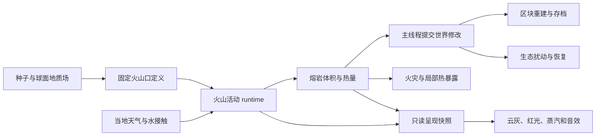

# 火山与地质活动设计草案

状态（2026-10-08）：G1 固定喷口/活动/存档/DSL、G2 有限熔岩/流动/冷却、G3 水接触反应，以及 P0 灰层、材料化冷却产物和分量采集已实现。热伤害、生态恢复及其他后续地质活动仍为提案。

以下保留全系统目标和后续设计，表格中的引燃、补给恢复等不代表当前能力；已交付边界、V29 存档与验证见 [实现记录](architecture/18-volcano-preview.md)。

当前只接受 V29 世界存档。下文 V25–V28 描述的是子系统载荷的历史引入与测试，不代表仍可读取那些旧世界文件。

## 下一轮实施优先级（2026-10-08）

按玩法缺口、前置依赖和可验证性排序。这里的 P0–P3 指后续工作的优先级，
不与下文已经交付的“P0 灰层”里程碑混用。

| 优先级 | 交付内容 | 验收条件 |
| --- | --- | --- |
| P0 活动控制（已交付） | 独立 `geology_enabled` 设置、暂停菜单开关、DSL 控制与状态查询 | 默认开启；关闭后火山、熔岩和灰层停止推进，保留分频余量、存档、碰撞和显示；恢复不补算；与天气破坏开关独立 |
| P1 热危害 | 中立的接触/近距热暴露查询；按来源区分点火策略；接入玩家与动物危害、动物回避 | 部分高度正确、不隔墙烫伤、不跨未知边界；冷岩不伤人；固定步伤害与读档一致；关闭活动不灭掉已有普通火灾 |
| P2 持续演化 | 有限地下补给账本；地质扰动记录；灰厚、温度、裸岩和年龄驱动生态恢复 | 物质守恒；耗尽后按明确补给规则恢复；恢复阶段确实影响生态；停放、容量耗尽和存档不重复补给或恢复 |
| P3 表现与调参 | 预警声、隆隆声、受预算限制的动态光、必要震感；自然频率与满载性能试玩 | 关闭粒子仍可辨认危险；画质和音量不改变物理；记录主线程和 GPU 峰值耗时 |

实施批次：先完整交付 P0（配置/调度 → 菜单/DSL → 回归与真实 Wayland 路线），
独立提交后再进入 P1。P1 先建立热暴露模型和来源策略，再启用破坏性接入；
P2 以持久化账本为前置，P3 在物理契约稳定后调参。每批实现同步更新本文和
`docs/debug-dsl.md`，执行相关单元测试、构建和适用的 DSL 验收，不以规划代替交付。

P0 验收记录：正常构建、架构检查和 7 项相关单元测试通过；Wayland DSL 验证
关闭时普通帧及显式步进冻结、非零时钟余量保留、热量/物质/碰撞与读档保持、
恢复不补算、跨进程配置持久化以及禁用时拒绝强制喷发。原有喷发回放、水接触和
分量采集路线通过。暂停菜单检查 960×720、960×640 和 480×320 三种布局，
修复原标准布局在较矮窗口中底部操作被裁切的问题。

## 1. 目标与第一版范围

让一个固定火山口能经历预兆、喷发、熔岩流动和冷却，留下可探索、
可开采、逐渐恢复的地貌。玩家能够提前察觉危险、判断流向、绕行或筑堤，
回来后仍能看到同一次喷发的结果。

第一版选择小规模玄武质溢流喷发：温度和黏度控制缓慢熔岩流，
少量喷溅和灰羽提供远处可见的信号。第一版不承诺真实板块运动、
大型爆炸性喷发、火山碎屑流、泥石流或动态山体崩塌。

已有基础：

- 行星表面场已有 `volcanicActivity`、火山锥、破火山口、熔岩通道形态。
  它们由种子与位置生成；独立火山 runtime 现已保存固定喷口和喷发事件。
- 有限熔岩流动、冷却、水反应及灰沉积已接入独立 runtime；冷却产物按材料参数生成，
  薄层采集保留分量，不把不足一格的沉积直接变成整格物品。
- `fluid` 的可流动体积和传输逻辑针对水，不能直接将岩浆接入现有水量数组。
- 已有固定模拟时钟、天气位置采样、火灾、生态、环境方块修改和原子存档。

成功标准：一条确定性 DSL 路线能从休眠走到冷却；体积账本闭合；
给定相同地形、水量和天气边界输入，改变帧率、图形质量或中途存读档
不会改变同一活动区的地质物理结果；
玩家离开再返回不重复喷发、不补放积压伤害、不重复生成岩石。

## 2. 玩家经历与活动状态

| 阶段 | 玩家能看到或听到 | 世界变化 |
| --- | --- | --- |
| 休眠 Dormant | 固定火山地貌，偶发弱气柱 | 补给恢复，等待下次活动条件 |
| 不安 Unrest | 气柱增强、低频隆隆声、局部轻震 | 压力升高，给出逃离和观察时间 |
| 喷发 Erupting | 喷口变亮、喷溅、沿坡流动的熔岩 | 有限岩浆库存持续释放；热量可引燃可燃物 |
| 衰退 Waning | 喷溅变少，流动逐渐停止 | 补给下降，已流出的岩浆仍继续流动和冷却 |
| 冷却 Cooling | 暗壳、局部红缝、接水蒸汽 | 熔岩固化，局部热危害下降 |
| 恢复 Recovery | 灰地、裸岩，随后出现先锋植被 | 地表扰动衰减，火山口可进入下一轮休眠 |

这些是可读标签，不是按计时器无条件播放的动画：压力与库存允许才释放岩浆，
通道堵住时不能穿墙生成；没有活动熔岩才能完成冷却阶段。
压力不等于真实地壳应力，第一版采用可调的现象模型。

初始调参范围建议：预兆 30–90 模拟秒、喷发 60–180 模拟秒，
冷却随体积、温度和水接触决定；恢复使用模拟日。它们是待试玩的参数，
不是科学尺度或已测得结果。正常 1× 时钟下模拟秒与现实秒一致。
雨水能增加冷却，不应几秒钟扑灭一个持续供给的喷口。

热伤害以接触岩浆和近距离辐射为主；弱灰羽先影响可见度和空气表现。
低质量画面仍要有可见红光和预警声，不能因关闭粒子而隐藏危险。

## 3. 核心对象与状态归属

| 对象 | 归属 | 关键内容 |
| --- | --- | --- |
| 火山口定义 VentDefinition | 确定性地质生成 | 稳定 ID、所在天体、球面地址、喷口位置、潜力、物质类型 |
| 火山口状态 VentState | 地质 runtime | 阶段、活动时间、压力、岩浆库存、补给、喷发序号 |
| 熔岩单元 LavaCell | 熔岩 runtime | 坐标、体积、热量、液相比例、上一 tick 的流向 |
| 地质扰动 GeologicalScar | 地质 runtime | 固化体积、灰沉积、热暴露、恢复进度；不重复保存火灾燃料 |
| 世界修改 TerrainMutation | 世界存储 | 实际方块变化、来源、修订号与持久化编辑 |
| 呈现快照 VolcanoVisualSnapshot | 表现层持有副本 | 喷口、灰羽、热辉光、流面、声音强度，全部从物理状态派生 |

地质 runtime 由游戏组合层创建和释放，主线程唯一拥有可变状态。
渲染器拥有 GPU 缓冲和粒子资源；世界卸载或程序退出时分别释放。
后台线程如果参与，只接收不可变地形/气候快照并返回候选结果，
不持有 Chunk 指针、不直接写方块。



图中箭头表示数据传递。推进顺序和存读档由 `app` 层控制；
表现层不反向修改物理。生态系统通过中立的扰动数据接口读取地质结果，
世界模块不导入生态实现。

## 4. 火山口在哪里

### 结构化火山地形（已实现）

`world/volcano_terrain` 是无状态、线程安全的地形模型。种子在六个立方体面上
选择间距 512、偏移 320 的中心（与活动喷口的 128 格候选网格对齐），
生成半径 110–145 格、高度 62–88 格、火山口半径 17–27 格和深度 25–38 格。
径向函数先定义外坡、口沿与凹陷；锚定中心的双通道坐标扭曲打破对称，
四层 FBM 与径向沟谷修饰外坡，山脚平滑归零。中心不随观察者、区块或时间改变。
球面采样枚举所有朝向采样点的立方体面，在面边和角点共享同一组山体贡献。
这是程序化山体，不宣称模拟了历史岩浆堆积；运行时熔岩仍使用现有有限体积模型。

第一阶段纯模型测试已验证火山口低于环形口沿、山脚归零、确定性、无效输入、
跨面邻域与全中心枚举一致，以及经线接缝连续。地形版本 9 已接入行星高度、
自然喷口和 DSL 实景验收；基础地貌在山体内平滑过渡到统一基座，
再叠加径向高度，保留完整的口沿与凹陷。

自然喷口复用山体定义中的中心与潜力值；128 格候选网格只接纳
通过 `VolcanoTerrainDefine` 的 512 格山体中心，并检查海拔和最小间距。候选点用稳定哈希排序，
邻区比较包含边界光环，避免经线接缝或两区同时生成同一个喷口。

稳定身份建议使用 `bodyId + SurfaceAddress + generatorVersion`，
不使用浮动局部原点，也不根据摄像机位置或发现顺序分配 ID。
地形采样可以发现候选定义；`inspect`、地图和渲染查询不能创建活动记录。
是否接纳活动记录由模拟调度器决定，检查已有保存状态后再初始化。

第一版自然火山优先用于已有火山地形的行星；本星球通过 DSL 验证。
本星球的自然火山分布作为后续地形版本单独评估，避免悄悄改变旧世界。
旧存档中的新喷口不能覆盖玩家编辑；喷口上已有建筑或未知区块时暂缓激活。

山体由地形采样生成，运行时只控制中心喷口、烟灰和熔岩。
这一步完成截图中的径向高度、坐标扭曲和 FBM；历史熔岩堆积塑造山体仍是独立后续任务。

### 第三项规划：历史熔岩流与堆积塑形（H0 已实现）

本节规划截图中的第三项，独立于已完成的活动开关 P0。
目标是让历史喷发形成可辨认的流路、凝固岩舌和山脚堆积，并真实改变高度、
材质与碰撞。已有 `LavaRuntimeStep` 提供实时体素流动、热量输运和凝固；
历史塑形需要一个有界、确定性的生成阶段，不能在每次高度查询中重放实时世界。

第一版保留现有径向山体作为初始地貌，模拟其上的历史堆积。
完全依靠长时间堆积生成盾状火山属于后续扩展；仅添加流纹或降低锥体坡度，
不算完成盾状火山的堆积生成。伤害、生态、音画不纳入本项。

#### 生成顺序与算法选择

`固定中心与参数 → 初始山体/火山口 → 有限次历史喷发 → 流动与凝固 → 堆积高度/材料 → 体素地形 → 实时活动`

优先采用火山局部球面切平面上的 2.5D 有限体积网格：每列保存初始地面高度、
固化厚度、活动熔岩体积与焓。按地面加固化层加液体厚度得到自由表面，
由相邻液面高差、邻格距离和液相比例计算流量。固定时间步、双缓冲、
稳定的剩余量分配保证遍历顺序不影响结果；不是只追踪一条最陡下降线。
复用现有热模型的焓和液相定义，但粗网格散热必须按实际面积与体积换算，
不能直接套用单个体素的 `LavaCool` 系数。第一版不模拟地下管道、侵蚀或坍塌。

历史喷发由种子给出有限的供给量、温度、间隔和源位置。固化会抬高下一次喷发
看到的地面，允许旧流路堵塞后改道。封闭火山口先蓄积，达到最低口沿才溢流；
需要侧向出流时使用明确、可查询的侧喷口定义，不能把中心熔岩直接搬到山坡。
不得在最后重新挖空火山口而丢失已沉积物质。

#### 按优先级实施

| 顺序 | 独立阶段 | 交付与验收 |
| --- | --- | --- |
| H0，已完成 | 历史流动/凝固纯模型 | 独立的 `volcano_deposition_model`；坡面向下流、盆地蓄积、越过鞍部、冷却停止；相同输入和反向遍历结果一致，体积及能量账本闭合。使用合成地形，不接世界生成。 |
| H1 | 多次喷发与地形反馈 | 接入现有山体定义和有限喷发序列；验证中心口内蓄积、溢流或侧喷口出流、旧沉积改道、岩舌与山脚增厚；输出高度差、材料、流经次数和账本。首个视觉样本必须确实流到山坡，不能只有口内填充。 |
| H2 | 世界生成与查询接入 | 增加不可变历史结果及有界缓存，接入地形高度和材料；完成跨区块、跨面、极区与重载一致性；碰撞、选取、地表查询和远景使用同一最终地形。此阶段递增地形生成版本。 |
| H3 | 实时喷发衔接与实景验收 | 实时喷口定位到历史堆积后的地面；确认活动开关、保存恢复和玩家编辑语义；DSL 提供历史参数/账本查询和固定相机对照，展示堆积前后、熔岩流路及凝固后地貌。 |

各阶段单独测试并提交，通过上一阶段验收后再推进。H0 完成后下一阶段为 H1；
世界接入、材质美化和盾状火山参数调优不属于 H0。

#### H0 实现契约

`world/volcano_deposition_model` 创建时复制初始高度，调用者拥有实例并负责销毁。
每个实例最多 128×128 列、100,000 个固定 0.1 秒步；参数在创建时校验，
所有工作数组一次分配，每步不分配内存，不读取世界或实时熔岩状态。
每列以 double 保存实际体积和焓，单位为方块体积及其归一化焓，
不沿用实时体素的 1024 单位容量。格宽允许 1–64 格、最大厚度不超过 1024 格。

柱内使用均匀热状态及现有 `lava_model` 的相变温度/潜热约定。
自由表面由初始地面加全部沉积厚度得到，只有液相能移动；输运携带液相焓，
留下固相。固化厚度由总量减液相得到，再次注入热熔岩可以改变该列液相比例。
这是柱平均近似，不含垂向分层、材料分离、地下渗流或跨固壳连通模型。

流量先由旧状态、液面高差、格间距及液相比例计算，限制单对邻格的均衡量，
再按源液量和目标剩余容量缩放。拒收量留在源列；外边界封闭。
每个源只写自己的四个通量槽，按固定邻接顺序归并，避免浮点累加顺序漂移。
保证同一构建下正反遍历逐格一致，不承诺不同平台数学库逐比特相同。

冷却按暴露顶面积乘固定散热系数计算，止于环境焓；它是可调的游戏尺度模型，
尚无温差相关辐射、底部导热或侧壁散热。等厚度的不同格宽具有相同单位体积
冷却率，薄层冷却更快。`Supply` 返回实际接纳量，未接纳量由调用者保留。
步数耗尽时 `Step` 返回 false，保留全部质量与热量；不暗中强制冷却。
历史生成结束后的收尾冷却策略由 H1 显式决定并计入账本。

查询提供液量、固化厚度、表面高度、温度，以及累计供给、保留量、散热和
当前边界体积。误差直接计算为 `供给体积 − 保留体积` 和
`供给焓 − 保留焓 − 散热`，不通过修正供给计数掩盖误差。
边界体积是当前诊断值，不是累计出界量；模型无出界出口。

`tests/test_volcano_deposition.c` 覆盖坡面、蓄积/溢流、停止流动、薄层与格宽缩放、
潜热阶段输运、多源容量竞争、步数上限、非法参数、平面对称扩散和最大网格。
2,000 步供给/冷却回放逐格对比正向与反向遍历，并逐步检查守恒误差
不超过 `1e-10 × max(1, 累计供给)`；体积与能量分别使用对应供给量。
另有 `geology deposition test slope|basin|overflow|cooling` 在游戏进程中运行
隔离模型，输出逐格检查点与账本；`tests/scenes/volcano_deposition.dsl` 自动断言
流动、蓄积、溢流和凝固结果。该入口不修改世界，输出用于数据图而非山体实景。

另提供可走动的固定山体演示：`bash scripts/run_volcano_mountain.sh`。
`geology deposition mountain` 现使用 `desert 1234` 行星上真正的自然火山，
半径约 112 格、高度约 70 格，山体由正常区块生成而非海量方块编辑构造。
128×128 的一格分辨率网格采样实际西侧山坡，5,000 步模拟两处明确侧喷口的
旧沉积与近期熔岩，总供给 2,160 方块；仅将沉积导入方块和热状态 overlay。
该固定演示布局接受半径 110–115 格的山体，不将它宣称为任意火山的历史生成器。
模型保留量与 1/1024 格导出量的量化损失单独报告；导出的熔岩/岩层支持渲染、
碰撞、采集及存读档。演示在独立临时目录中关闭持续地质活动，以保留观察快照。
导入前检查模拟边界、热单元与总记录预算，不提高现有 runtime 容量限制。
这是面向游戏实景的 H1 预览；自然山体已经使用正式地形生成，但通用历史缓存、
全行星历史沉积与 H2 接入仍未完成。

#### 实时主火山口阶段

可游玩入口改为 `volcano_live.dsl`：自然地形与正常熔岩 runtime 直接连接，
不导入 H0 快照，也不在山坡布置供给点。脚本只提前触发自然喷口事件并快进，
完成加载、流动、部分凝固、保存恢复检查后交还键鼠，继续正常实时更新。

本阶段实现带缺口的火山口：V10 地形按种子生成内侧门槛和下坡槽；中心口底
持续供给，填满的熔岩格上方可以接收后续供给，口底真实冷岩提交后抬高出口。
玩家放置的封口不会触发出口抬升。自然库存 4096 方，最大供给 4 方/秒，
自然喷发持续 900–1200 活动秒；强制创建的小诊断喷口仍为 256 方。

冷却按接触/暴露面积计算：相邻熔岩遮挡侧面，顶部覆盖减少散热；已加载岩壁
视作热汇，埋藏单元保留小量有效散热。基础游戏散热系数由 8 调至 0.5，
液态流量上限由每步 1/4 格调至 1 格；部分凝固仍减速，预算拒绝仍留在源内。
这些是游戏尺度近似，不是完整热传导/辐射求解器。库存、2048 热格与 8192
总记录上限不放宽；达到预算时减慢出流，不偷偷丢弃熔岩。

该阶段不代表 H1–H3 全部完成：全行星多次喷发历史、不可变历史缓存、封闭
大型熔岩湖和历史沉积驱动的世界生成仍需独立推进。

#### 状态、边界与生成成本

- 历史模型只接收不可变初始地形与生成参数，不查询加载区块、不推进实时活动时钟。
  初始高度采样与最终高度采样必须拆开，防止历史生成递归调用自身。
- 历史结果由行星种子、完整地形参数、稳定火山地址和生成器版本决定。
  缓存只影响性能，不影响结果；同一键只构建一次，构建完成后只读发布，
  在用结果不能被淘汰。区块生成等待对应结果，不能先返回无堆积高度再悄悄替换。
- 网格大小、分辨率、喷发次数、步数和缓存容量均设硬上限。原型先比较 2/4/8 格
  分辨率的形态与成本；H1 测量后再固定默认值，不预先承诺性能数字。
  达到步数上限时保留剩余熔岩并计入终态冷却账本，不能清空数组或凭空补成整块。
- 模拟范围必须覆盖山脚和预期岩舌，并提供边界余量。原型边界封闭，记录触边量；
  首批验收种子要求无触边堆积伪影。若需跨域输运，必须设计守恒交接后再开放，
  不允许直接丢弃出界物质。海水接触留待扩展，首批使用干燥地形。
- 球面地址确定唯一局部域，不以当前区块为中心重跑模拟。相邻火山影响域相交时，
  首版以稳定优先级选择参与历史模拟的定义，使有效域不相交；未入选的山体仍保留
  现有基础地形。选择不能依赖发现顺序。联合历史模拟留作后续。
- 高度上限和体素量化不能静默吞掉沉积。受限空间保留源库存或明确记录剩余量；
  模型守恒与体素表示误差分别统计，薄层量化方案在 H2 固定并加入验收。
- 历史沉积进入程序化基底，玩家编辑和运行时环境修改覆盖其上。它不消耗当前
  喷口的 256 格库存，不向实时熔岩账本重复注入；关闭活动也不移除历史山体。
  重载按相同版本/参数重建，世界元数据校验必须覆盖新增参数。

H2 性能验收记录单火山构建耗时、峰值内存、缓存命中率和冷热缓存区块生成耗时，
与当前版本基线对照；预算超限先降低历史网格或批次成本，不删去守恒检查。
H3 在同种子、同机位下对比无历史堆积与有堆积的实机图，至少覆盖三组种子、
一处立方体面边界和一处极区。DSL 断言通过和截图输出成功不替代实际视觉检查。

## 5. 熔岩、冷却和水的交互

独立实现 `lava_model` 与 `lava_runtime`，沿用水流模块的固定步、体积计量和
区块接口经验，先不把水求解器重写成通用多流体系统。

模型至少保存体积与显热/潜热账本。混合时合并体积和热量后求温度，
不能直接平均温度；冷却先降低热量，再改变液相比例与黏度。
优先向下流，再根据液面高差向侧面传输。冷岩浆黏度大、流速慢，
不具备无限复制的“源方块”。喷口是唯一新增物质量的显式来源。

每个 tick 使用前一状态计算通量，再一次性提交，避免数组遍历顺序改变流向。
边界未加载就按不透流处理，保留上游体积；不能把未知区块当空气。
静态生成的岩浆海不自动升级成无限供给源，第一版只管理喷发拥有的岩浆。

物质守恒必须满足：

`初始岩浆库存 + 累计地下补给 = 喷口剩余库存 + 活动熔岩 + 已固化岩石 + 明确记录的移出量`

第一版不允许跨未知边界泄流，该项移出量应为零；玩家开采、收集或
明确销毁物质要记入移出量。停止供给和限流都必须保留库存。
灰与喷出固体若有实际沉积，使用单独的物质账本，并从喷发物源扣除，
不能根据视觉粒子数量生成可开采物。此账本按固定密度的等效体积计量，
第一版不模拟冷却收缩和成分分离。
冷却为岩石需要保存固相体积：不能把任意少量岩浆变成一个完整岩石方块。
不足一方块时先保留部分固化单元和相应表面/碰撞高度，足量后才转为普通岩石。
这部分网格和碰撞支持属于熔岩阶段的必要工作。完全冷却的部分固体转入
持久化沉积记录，不继续占用热熔岩活动预算；再次被熔岩覆盖时重新接纳。

慢冷以玄武岩为主；快速水冷可产生黑曜石，使用简化材料规则并在文档注明。
接水时由游戏层按固定顺序同时提交取水、失热、固化和蒸汽通量，
任一条件失效就整个反应重新计算，避免水和熔岩都自称消耗了同一份水。
蒸汽先做视觉和排出通量，不增加气体流体求解器。爆炸和蒸汽压力不在第一版。

## 6. 接入现有系统

| 系统 | 接入方式 | 明确边界 |
| --- | --- | --- |
| 天气 | 按火山口、熔岩位置采样温度、降水、风 | 风吹灰羽，不决定地下岩浆补给 |
| 火灾 | 热暴露达到阈值后通过统一点火入口提交来源与强度 | 火山不另建一套燃烧状态；需要拆开现有天气伤害开关与点火来源策略 |
| 水流 | 接触反应通过应用层协调双方体积提交 | 不在水求解器里隐式生成、删除岩浆 |
| 世界 | 环境来源的方块修改、区段脏标记合并 | 提交时核验修订号，避免旧结果覆盖玩家刚放置的方块 |
| 动物与玩家 | 中立的温度/热暴露/危险区域采样 | 伤害与逃离由各自玩法系统决定 |
| 生态 | 灰厚、温度、裸岩比例、扰动年龄输入区域环境 | 少量冷灰可能改善矿物供应；厚灰覆盖和热熔岩先抑制生长 |
| 光照与音效 | 红光、喷溅、灰羽、隆隆声由快照派生 | 剔除或丢弃视觉粒子不能影响体积、伤害和随机序列 |

第一版只做局部灰羽遮光和落灰；不接入全球辐射柱，也不产生全球降温。
灰沉积对营养状态的作用应经过现有营养输入账本，不能无上限增加肥力。

增加独立的“火山活动影响”开关：关闭时暂停该子系统的物理推进和伤害，
保留已保存状态、既有地貌和可见熔岩；重新开启从该状态继续，不补算关闭期间。
此前已经点燃的普通火灾由火灾系统继续管理，关闭火山不能回滚它们。
默认值在实施阶段统一纳入设置迁移测试。DSL 预览在隔离测试世界运行，
停止效果不能冒充回滚已经产生的永久地形修改。

## 7. 时间、加载范围与预算

火山生命周期拟采用 2 Hz，熔岩传输拟采用 10 Hz，均由现有 60 Hz
固定模拟步触发；渲染按快照插值。具体频率要经过流速与稳定性测试。

初始活动预算建议：同时 2 个详细喷发，活动熔岩总量最多 2,048 单元，
灰沉积每地质 tick 最多 32 个候选列。均为待测起点，不是性能承诺。
已接纳的全部熔岩必须每个物理 tick 推进；不能通过轮询漏算时间来省成本。
容量不足时限制喷口释放和向新单元扩张，保留物质和显式受限状态。
可合并一个 tick 的区块重建请求，不按每滴岩浆重建网格。

第一版加载语义明确采用局部模拟：

1. 火山进入详细模拟范围后，固定步推进；在范围内转头或改变画质不影响结果。
2. 离开范围或切换天体时，在完整物理步边界将事件与流场停放并保存。
3. 停放期间不持续喷发、不积累待释放岩浆，也不远程破坏方块。
4. 返回后恢复同一事件及同一活动时间，不将墙钟经过时间转换成补喷发。
   边界尚未加载的单元仍保持不透流。
5. 接纳使用距离滞回和稳定 ID 排序，防止边缘来回切换；活动容量满则候选等待，
   不挤掉正在喷发的已接纳事件。直接跨世界传送允许停放。

这不模拟玩家离开期间的地质演化。未来若做离屏宏观演化，需要另加守恒的
粗网格和事件日志，不能仅推进阶段时间再事后补写地形。
大幅快进同样遵守这一边界，先停放详细地质域，不能跳过中间物理步骤。

地质记录的持久化存储与活动预算分开：休眠/停放不等于可以丢弃。
达到存储限制时停止接纳新事件并提供计数，不淘汰尚有熔岩或玩家可见结果的记录。

## 8. 持久化和正确性

增加独立、带版本的地质 payload，由现有原子世界存档写入；提升世界格式版本，
旧档缺少 payload 时初始化空 runtime。定义明确字节编码，避免直接写 C 结构体布局。
载入先完整校验临时状态，再提交，不让损坏 payload 留下半恢复的活动。

保存内容包括稳定火山口身份、生成版本、事件序号、阶段、活动时间、
压力/库存、活动和停放域、熔岩体积/热量/固相、沉积与恢复状态、
采样游标及随机计数器。存档在完整 tick 提交后截取，保存分频余量或规范化检查点。
瞬时粒子、GPU 资源和待显示音效不保存。

必须维持的约束：

- 一个球面火山口只有一份状态，经线/极点别名不能复制火山。
- 读查询无副作用；看地图、截图和暂停不会触发新喷发。
- 物理随机数按火山口和事件分流，不能与粒子随机数共用。
- 点火、沉积、固化有事件/步骤身份，恢复不能重复执行副作用。
- 两条熔岩流汇合后由空间单元唯一拥有体积；单元不随某个喷口退出而被删除。
- 世界编辑完成后，再发布物理结果与渲染快照；异步结果按世界代次和修订号校验。
- 冷却岩石和灰层是永久环境修改，不套用天气雪冰的自动还原逻辑。

## 9. 最容易出问题的情形

| 情形 | 处理与验证 |
| --- | --- |
| 玩家在熔岩前沿放墙 | 重读方块，重新计算可容纳体积；不能穿墙或丢失岩浆 |
| 喷口被封住 | 不凭空排出物质；压力饱和时停补给并记录受阻，第一版不隐式炸开建筑 |
| 玩家传送导致区块卸载 | tick 边界停放；未知边界不透流；返回不一次性补做伤害 |
| 满载、多流汇合 | 限制接纳和新增体积单元；保留库存，所有已接纳单元持续按时推进 |
| 高温冷却恰好遇到保存 | checkpoint 前完成反应和方块提交，恢复后既不双重取水也不多生成岩石 |
| 后台地形结果在切换行星后返回 | 世界代次不符就丢弃候选结果，不影响已保存状态 |
| 关闭粒子或音效 | 只改变表现；热量、物质、伤害和事件序列相同 |

## 10. 建议模块与交付阶段

| 阶段 | 交付内容 | 验收重点 |
| --- | --- | --- |
| G1 火山口与事件 | `volcano_model`、runtime、固定候选身份、状态机、保存、DSL；先用小灰羽与红光预览 | 重载不重置、跨极点不重复、暂停不前进、序号可回放 |
| G2 熔岩闭环 | `lava_model/runtime`、有限供给、部分体积网格/碰撞、热量与固化 | 封闭盆地与斜坡体积守恒，单元容量变化不改变推进速度 |
| G3 世界交互 | 水接触、统一点火、热危害、环境编辑、玩家筑堤 | 不穿墙、不覆写过期玩家编辑，存读档副作用一致 |
| G4 表现与恢复 | 风驱灰羽、声音、灰层、动物回避、生态扰动与恢复 | 画质独立、效果预算、自然活动频率试玩、满载帧耗时 |

每个阶段独立提交。G1 是调试预览可用，G2–G3 完成后才称为可玩的火山闭环；
不把只有状态机和粒子宣称为完整地质系统。

未来模块边界建议：`world/volcano_model` 只接收参数和显式状态，
`world/volcano_runtime` 管理活动和停放记录，`world/lava_*` 管理流体与热量，
`app/game_geology` 负责时钟、天气、水与火灾接口和保存装配，
`presentation/render_volcano` 读取快照绘制。第一版主线程实现，
测到瓶颈后再考虑后台计算，不提前引入并发状态所有权。

## 11. 拟议调试与测试

下列命令已在 G1 实现；物质量、热量及损伤诊断仍待后续阶段。
当前接口与范围见 `docs/debug-dsl.md` 的 Geology preview 一节。

```text
geology inspect
geology vents
geology force eruption INTENSITY TICKS
geology stop ID
geology step TICKS
```

`force` 使用确定性的附近测试喷口并走正常物理路径，`stop` 停止供给，
保留已经流出的熔岩与地形结果。`step` 以地质固定 tick 为单位推进，
每 tick 执行对应数量的熔岩子步；命令本身不推进整个世界时钟，
当地天气以命令起始时间冻结，返回中明确报告这项语义。

拟议只读字段：阶段、ID、活动秒数、库存、岩浆/固相总量、活动单元数、
未加载边界数、拒绝接纳数、累计点火/固化次数、体积误差和 CPU 耗时。

验证路线覆盖：相同种子与输入的确定性；同一路线不同渲染帧长；
暂停/快进；喷发中保存；水冷反应中保存；卸载与返回；经线与极点别名；
玩家封口与筑堤；容量耗尽；两股熔岩汇合；关闭全部粒子；旧档与坏档。
图形验收使用现有 Wayland/Hyprland DSL，检查至少预兆、喷发、流动、
水冷蒸汽和冷却后地貌，不使用外部窗口控制替代项目调试接口。

首要测量是主线程物理耗时、单 tick 修改区段数、网格重建队列、峰值内存和
GPU 灰羽/熔岩通道耗时。必须区分物理开销与渲染开销，不用平均 FPS 掩盖尖峰。

跨系统回放先使用固定步水流和显式边界输入。现有 `FluidUpdate` 有运行时
工作预算，不能仅凭地质模块确定性就承诺整个水流世界在不同机器上逐 tick 相同；
集成测试必须锁定参与反应的水流推进契约。

## 12. 后续地质活动顺序

### G3 第一阶段实施契约

水—熔岩反应使用主线程 10 Hz 回调：熔岩流动提交后，按稳定单元顺序检查六面，
核对水量并原子汽化，再扣除熔岩焓、累计蒸汽通量，最后进行环境冷却与玄武岩固化。
侧面接触面积取两种物质高度的较小值；上下接触要求下格填满，部分格间的空气不导热。
热固相仍可把能量传给水，部分固相保持 overlay，不补成整块玄武岩。

这是离散水包近似，尚无水温场：假设入水 293 K、沸点 373 K，归一化水比热 1.5、
汽化潜热 900。每个 1/255 方块水包的升温加汽化能量为 4096 熔岩焓单位。
导热系数为每面每秒每 K 128 焓单位，乘实际接触面积与高于沸点的温差。
不足一个水包的六面接触额度存于熔岩单元，**不扣除焓**；水量提交成功才扣热，
低于沸点的余热交给环境冷却。未知边界停放额度，已知失去接触则清零。
这不是可移动、可查询的水温模型；后续若加入水温，必须连同水流输运一起设计。

有限水体实际扣量并持久化；程序化海洋沿用已有自动补满语义，额外记录外部补给。
水量关系为 `初始有限水量 + 海洋补给 = 剩余水量 + 累计汽化`（封闭测试场景），
熔岩能量关系为 `供给 = 剩余 + 环境散热 + 水包汽化耗热 + 固化导出`。
封闭空间不模拟蒸汽压力、爆炸或冷凝，蒸汽作为质量和能量的出口。

世界格式 V26 写入 `LAVA0002`，保存汽化/海洋补给计数、耗热和六面余量；
仍读取 V25 的 `LAVA0001`，旧版新增量初始化为零。载入验证计数关系、能量守恒、
有限余量及单元边界，失败不修改 runtime。表现用的近期蒸汽强度不进入存档。

### P0 已实施：灰层和冷却产物

灰层使用独立的 10 Hz 有限体积记录（每格 1024 单位，最多 2048 格），
支持累积厚度、重力下落、薄层碰撞与选取、保存和卸载停放。喷灰从火山库存扣量；
裸露顶层按降雨/毛毛雨强度每秒最多流失 2 单位，记入冲刷出口账本。
遮雨检查限定上方 12 格；更高屋顶不在当前近似范围。灰量满足
`累计供给 = 留存 + 冲刷出口 + 采集出口`。这里尚未实现泥沙搬运或泥流。分量采集现已接入左键交互。

熔岩增加随体积混合与输运的富硅、含气和水冷历史标记：致密基性材料生成玄武岩，
致密富硅材料缓冷生成流纹岩、足量水冷生成黑曜石；高含气基性/富硅材料分别生成
火山渣/浮石。天然喷口按稳定身份和种子选材料原型，强制测试喷口沿用基性材料。
这些是固定密度、格内均匀混合的游戏规则；冷却历史经再加热仍保留，
尚不模拟气泡膨胀、玻璃重结晶或矿物结晶动力学。

世界格式 V27 保存 `LAVA0003` 材料标记和 `ASH00001` 灰层/雨蚀余量；
旧版熔岩默认基性致密材料，V26 及以前读入空灰层。调试新增
`geology deposit ash|basalt|silicic|scoria|pumice X Y Z UNITS`，走正常接纳规则，
将注入量记入显式调试源供给。无调试注入时，单喷口的
`剩余库存 + 累计熔岩供给 + 累计灰供给 = 256` 方块。

### 薄层定量采集已实施

左键移除所指灰层或已冷却岩层的实际体积，各材料余量独立累计，满 1024 单位
转换为一个可放置方块；采集提示和快捷栏显示余量进度。仍含液态或未降到环境温度
的熔岩不允许采集。同材料背包达到 999 块时不移除原物，已持有余量不会丢失。
采集事务核对体积/材料、提交源移除，再无失败分支地计入背包；灰量纳入采集出口，
冷岩体积及剩余热量纳入原有移除/能量导出账本。移除会唤醒邻近水流，支撑变化
在下一地质步引起灰层下落，不写入普通地形撤销历史。

V28 在灰层后保存 `INVFR001` 六种材料余量，并用 `ASH00002` 保存累计灰采集量。
保留旧版整块背包布局，V27 及以前载入零余量，坏余量载入失败并由整存档事务回滚。
新增采集 DSL 路线验证真实左键操作、满背包拒绝、雨蚀与支撑移除、凑整块和读档恢复。

| 顺序 | 活动 | 复用的基础与新增难点 |
| --- | --- | --- |
| 1 | 喷气孔、地热区、温泉 | 复用固定热源、热暴露、水接触；补地下水供给和温度接口 |
| 2 | 局部地震 | 复用事件、预兆与固定地址；先做局部震感，再接结构承载和掉落物 |
| 3 | 火山灰遇雨形成泥流 | 需要沉积物搬运、地形坡度和有限水量共同守恒 |
| 4 | 滑坡、塌陷 | 需要地形稳定性、支撑关系和批量体素搬运，不能靠随机删块 |
| 5 | 地壳抬升与板块演化 | 会影响全球地形、水系、存档版本和坐标体系，单列长期项目 |

建议先交付 G1–G3，再依据实际游玩判断加入地热或地震。
